# AI-Driven SOC - Experiment Report

> All numbers below are read from files produced by the experiment scripts. Unless a real dataset path is configured, the data is **synthetic**; results must not be presented as real-world findings.

## 1. Dataset description
Dataset `synthetic`: 12152 rows, 25 columns. Class counts: {'BENIGN': 9612, 'PortScan': 778, 'DoS': 646, 'BruteForce': 635, 'Exfiltration': 481}. Imbalance ratio (majority/minority): 19.98.

## 2. Experimental setup
Stratified 70/15/15 split (seed 42); preprocessing (imputation medians, feature selection, encoding) fitted on the training split only; model selection on validation macro-F1; all reported metrics from the held-out test split. SOC comparison uses a separate unseen workload (different generator seed).

## 3. Algorithms
- **random_forest**: {'n_estimators': 200, 'max_depth': None, 'min_samples_leaf': 2, 'class_weight': 'balanced_subsample', 'n_jobs': -1, 'random_state': 42} (train rows 8506, 0.8s)
- **xgboost**: {'n_estimators': 250, 'max_depth': 6, 'learning_rate': 0.1, 'subsample': 0.9, 'colsample_bytree': 0.9, 'tree_method': 'hist', 'eval_metric': 'mlogloss', 'random_state': 42, 'n_jobs': -1} (train rows 8506, 1.5s)
- **logistic_regression**: {'max_iter': 2000, 'C': 1.0, 'class_weight': 'balanced', 'random_state': 42} (train rows 8506, 0.11s)
- **isolation_forest**: {'n_estimators': 200} (train rows benign only, -s)

## 4. Evaluation metrics (test set, binary: malicious vs benign)

| Model | Precision | Recall | F1 | FPR | FNR | MCC | AUC-ROC | AUC-PR |
|---|---|---|---|---|---|---|---|---|
| random_forest | 0.9 | 0.9685 | 0.933 | 0.02843 | 0.0315 | 0.91547 | 0.99076 | 0.96463 |
| xgboost | 0.91457 | 0.95538 | 0.93453 | 0.02358 | 0.04462 | 0.91711 | 0.99273 | 0.9721 |
| logistic_regression | 0.78631 | 0.99475 | 0.87833 | 0.07143 | 0.00525 | 0.85126 | 0.98949 | 0.95028 |
| isolation_forest | 0.80657 | 0.58005 | 0.67481 | 0.03675 | 0.41995 | 0.61813 | 0.86988 | 0.73209 |

Best model by validation macro-F1: **random_forest**.

## 5. Confusion matrices, ROC and PR curves
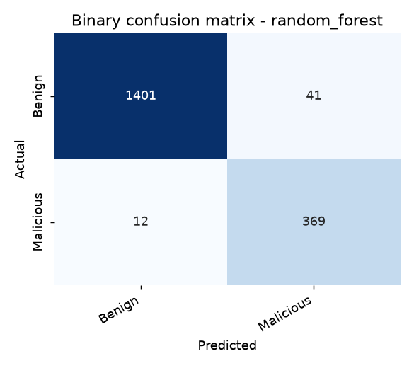
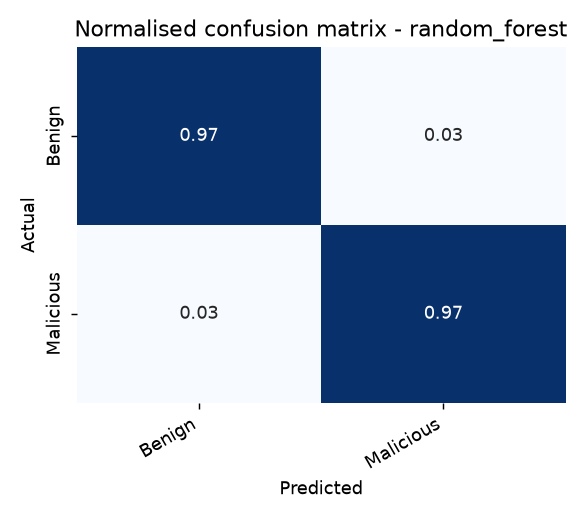
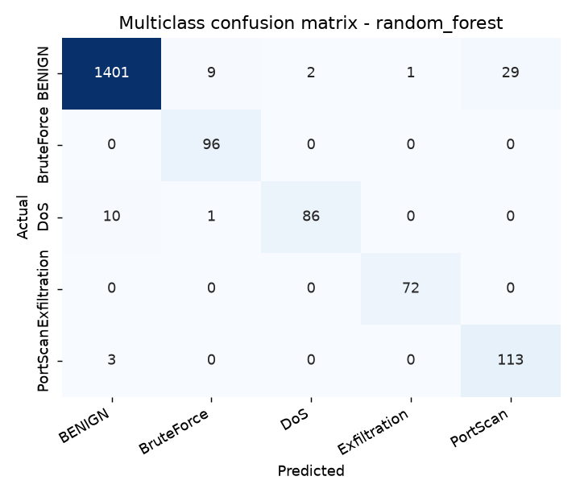
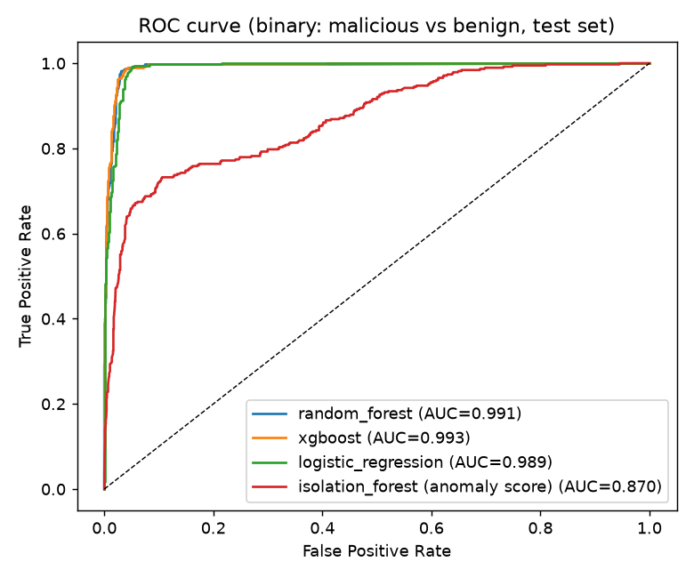
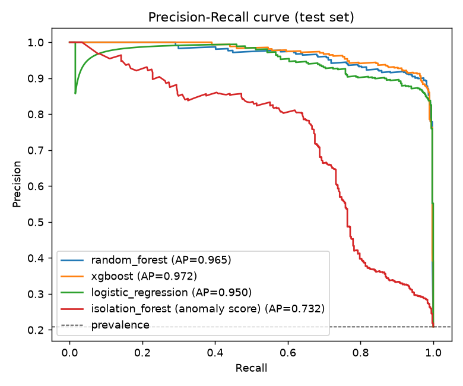
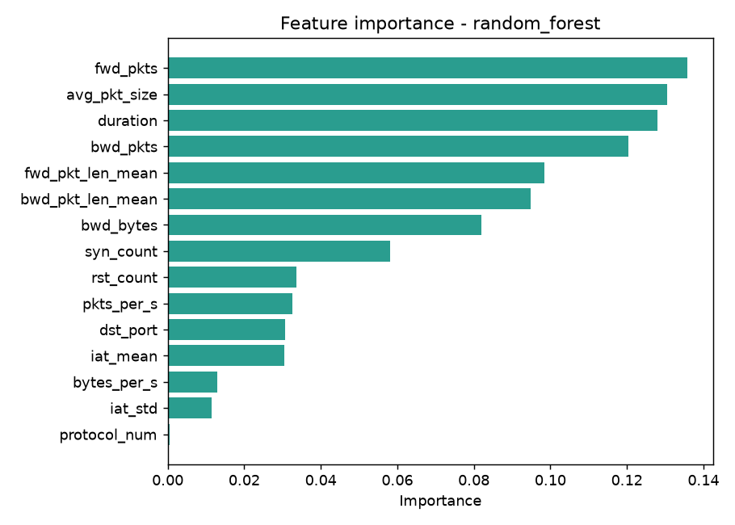
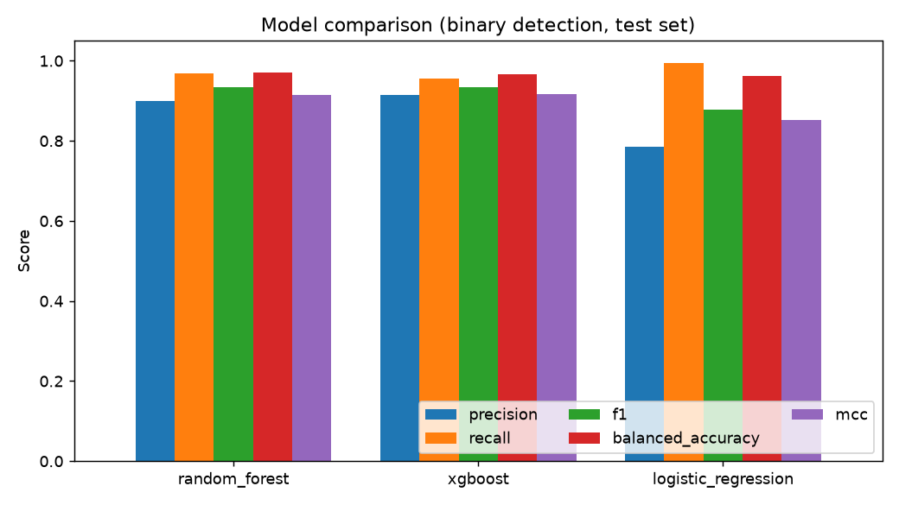
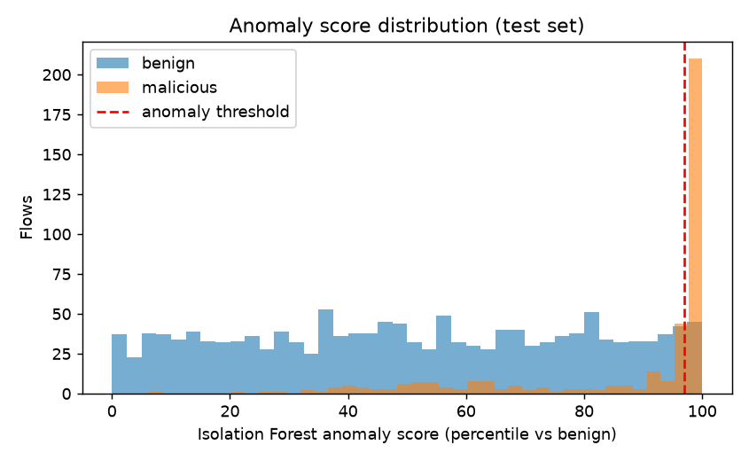

## 6. LLM evaluation
Cases: 9; configurations: ['offline+RAG', 'offline,noRAG', 'ollama+RAG']; not run: ['openai'].

```json
{
 "offline+RAG": {
  "json_valid": 1.0,
  "threat_type_match": 1.0,
  "mitre_precision": 0.8611,
  "mitre_recall": 0.6852,
  "faithfulness": 1.0,
  "context_precision": 0.7778,
  "context_recall": 0.6852,
  "evidence_keyword_coverage": 1.0,
  "recommendation_keyword_coverage": 0.5018,
  "answer_relevancy": 0.2093,
  "hallucinated": 0.0,
  "latency_s": 0.0007,
  "prompt_tokens": 734.8889,
  "completion_tokens": 435.3333,
  "cost_usd": 0.0
 },
 "offline,noRAG": {
  "json_valid": 1.0,
  "threat_type_match": 1.0,
  "mitre_precision": 1.0,
  "mitre_recall": 0.4629,
  "faithfulness": 1.0,
  "context_precision": null,
  "context_recall": null,
  "evidence_keyword_coverage": 1.0,
  "recommendation_keyword_coverage": 0.0222,
  "answer_relevancy": 0.1597,
  "hallucinated": 0.0,
  "latency_s": 0.0002,
  "prompt_tokens": 323.5556,
  "completion_tokens": 401.5556,
  "cost_usd": 0.0
 },
 "ollama+RAG": {
  "json_valid": 1.0,
  "threat_type_match": 0.2222,
  "mitre_precision": 0.7871,
  "mitre_recall": 0.7963,
  "faithfulness": 0.9576,
  "context_precision": 0.7778,
  "context_recall": 0.6852,
  "evidence_keyword_coverage": 1.0,
  "recommendation_keyword_coverage": 0.8889,
  "answer_relevancy": 0.2459,
  "hallucinated": 0.0,
  "latency_s": 92.1584,
  "prompt_tokens": 1269.3333,
  "completion_tokens": 491.4444,
  "cost_usd": 0.0
 }
}
```
Caveats: offline provider is a deterministic template, not an LLM: its scores show pipeline/guardrail behaviour, not LLM capability | tokens for offline provider are estimated as chars/4 | 9 curated cases: results are illustrative, not statistically powered

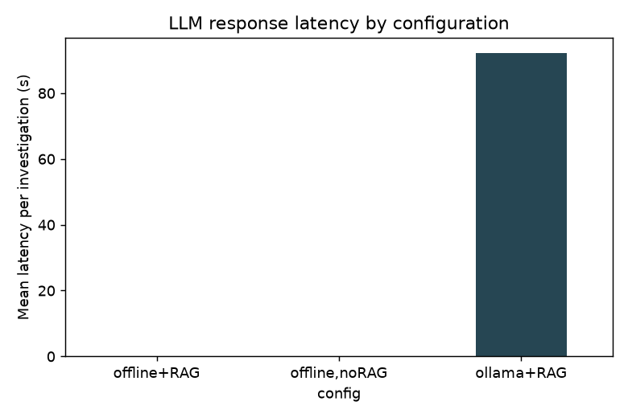

## 7. Traditional vs AI SOC comparison
| config   | name                                                |   precision |   recall |      f1 |   false_positive_rate |   false_negative_rate |   incidents |   MTTD_min |   MTTA_min |   MTTR_min |   alert_reduction_vs_A |
|:---------|:----------------------------------------------------|------------:|---------:|--------:|----------------------:|----------------------:|------------:|-----------:|-----------:|-----------:|-----------------------:|
| A        | Traditional SOC (rules)                             |     0.84615 |  0.64565 | 0.73243 |               0.03347 |               0.35435 |         102 |      0.077 |      1.054 |     29.054 |                 0      |
| B        | ML SOC (rules + ML)                                 |     0.87366 |  0.97717 | 0.92252 |               0.04029 |               0.02283 |         140 |      0.126 |      2.923 |     30.923 |                -0.3725 |
| C        | LLM SOC (rules + LLM investigation)                 |     0.84615 |  0.64565 | 0.73243 |               0.03347 |               0.35435 |         102 |      0.077 |      0.383 |     25.183 |                 0      |
| D        | Combined AI SOC (rules + ML + anomaly + LLM + risk) |     0.85308 |  0.97826 | 0.91139 |               0.04803 |               0.02174 |         166 |      0.172 |      0.975 |     25.775 |                -0.6275 |

Endpoint rules (no ML): {'events': 1277, 'precision': 0.89259, 'recall': 0.87004, 'f1': 0.88117, 'false_positive_rate': 0.029, 'false_negative_rate': 0.12996}

LLM detection credit: None. Config C detection == config A by design; the LLM is not part of the detection decision.

Assumptions: {"analysts": 2, "triage_minutes": 8.0, "llm_time_factor": 0.6, "ack_sla_minutes": 15.0, "respond_sla_minutes": 240.0, "response_minutes": 20.0, "ml_inference_delay_s": 0.5, "note": "MTTD/MTTA/MTTR and investigation time come from a SIMULATED analyst queue with these assumed parameters; detection metrics are measured from actual predictions; LLM latency/tokens are measured (offline template provider unless configured)."}

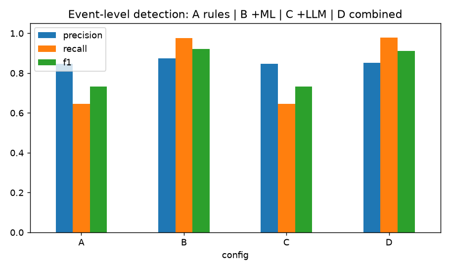
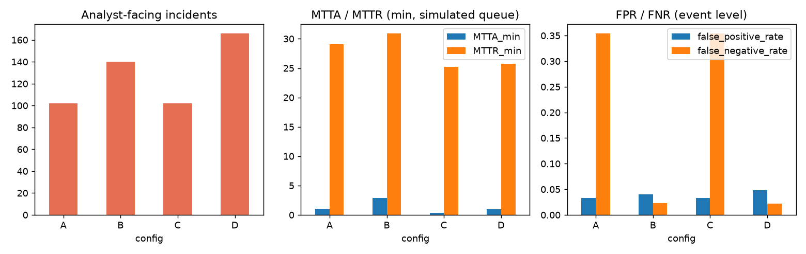

## 8. Limitations
- Synthetic data with generator-defined overlap; real-dataset performance will differ (CIC-IDS2017 etc. are supported via dataset config but not bundled).
- Flows from the same attack burst can appear in both train and test splits (flow-level, not burst-level split) - optimistic bias.
- Analyst-queue timings (MTTA/MTTR/investigation time) are simulated from assumed parameters, not measured with humans.
- Offline LLM provider is a template; LLM metrics reflect guardrail/pipeline behaviour unless OpenAI/Ollama was configured.
- RAG uses TF-IDF by default; semantic embeddings (sentence-transformers) are optional.
- Rule-based detection thresholds are illustrative.

## 9. Conclusion
The measured results show whether ML and anomaly detection add recall beyond fixed rules and what that costs in alert volume; see the tables above for the actual figures. LLM components were evaluated for grounding, validity and cost, not credited with detection.